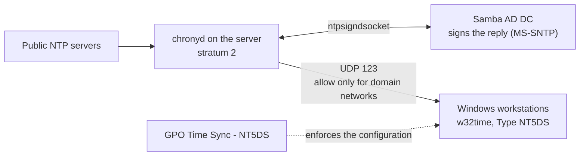

# samba-ad-time-sync

[Português](README.md) · **English** · [Español (Honduras)](README.es-HN.md)

Fixes clock drift of several minutes between the Windows workstations of a Samba AD domain: the server starts answering **signed** time (MS-SNTP) through chrony, and a Group Policy standardizes the clients' configuration.

## The problem

In a Samba AD domain, some Windows workstations had clocks that differed by minutes, some ahead and some behind. Mismatched time is more than an annoyance: Kerberos, used for domain logons, tolerates about 5 minutes of difference by default, and event logs from different machines stop being comparable.

What we found:

- The server (domain controller) had the **correct** time, synchronized with public NTP servers.
- The workstations we measured used `Local CMOS Clock` as their source, were flagged as "not synchronized" and had never synchronized. Their difference from the server was about 1.75 s, 11.2 s and 128 s.
- The clients' configuration was already right (`Type: NT5DS`) and the domain already advertised the server as a time server.
- The cause was the server **not answering signed time** to the clients. With no valid answer, each clock followed its own hardware and drifted.

This repository gathers the diagnosis, the changes and the checks that fixed it.

## How it works (overview)



In short:

- The server's **`chronyd`** synchronizes with public NTP servers and starts serving time to the networks listed in the `allow` directive.
- The **`ntpsigndsocket`** directive connects chrony to Samba's signing socket. Windows only accepts a domain controller's answer if it is signed, and Samba is what signs it.
- The `chrony` user needs **access to that socket's directory** (group `chrony`, mode 750). It is the only permission change.
- Clients with **`Type: NT5DS`** discover the time server through the domain itself, with no server to point at by hand.
- The **GPO** is the second layer: it makes sure every workstation has the NTP client enabled and set to NT5DS. It does not replace a healthy server.
- For small differences, Windows corrects the clock **gradually** (slew), with no jump. An 11 s difference took about 30 minutes to disappear.

## Repository layout

```
samba-ad-time-sync/
├── configs/    chrony.conf.example
└── docs/       pt-BR/, en/, es-HN/
                (runbook, rollback, lessons learned)
```

## Requirements

- A **Samba AD DC** with `ntp_signd` support. Confirm with `samba -b | grep -i NTP_SIGND_SOCKET_DIR`. The socket path depends on the installation (in this project, Samba compiled from source under `/usr/local/samba`).
- **chrony** with signing support (`chronyd -v` should show `+SIGND`).
- Windows workstations joined to the domain, with `w32time` and the `w32tm` and `gpresult` tools.
- Access to Group Policy Management (RSAT) on a domain-joined machine.
- UDP 123 open between the workstation networks and the server.
- Tested system: Rocky Linux 10.x on a virtual machine. Other distributions should work with adjusted paths.

## Step-by-step deployment

The full guide, with every command, is in [docs/en/runbook.md](docs/en/runbook.md). In short:

1. **Diagnose** the client: `w32tm /query /source`, `w32tm /query /status` and `w32tm /stripchart` against the server. A `Local CMOS Clock` source with "not synchronized" means the workstation is not using the domain.
2. **Confirm the server is right**: `chronyc tracking` with `Leap status: Normal` and a small offset.
3. **Give the `chrony` user access to the signing socket** (`chgrp chrony` and `chmod 750` on the `ntp_signd` directory).
4. **Back up** `chrony.conf` and append the lines from [configs/chrony.conf.example](configs/chrony.conf.example) (`allow` only for the networks that have domain machines, and `ntpsigndsocket`).
5. **Restart `chronyd`** and check the log for `MS-SNTP authentication enabled`.
6. **Test on one workstation**: `w32tm /resync /rediscover` and wait for the gradual correction.
7. **Roll out the GPO in phases**: unlinked first, then limited to a test workstation, then with a workstation WMI filter, and finally for all.
8. **Validate** and document. To undo any part, see [docs/en/rollback.md](docs/en/rollback.md).

## How to validate

On the server:

```
chronyc tracking | grep -E "Stratum|Leap|System time"    # Leap status: Normal
ss -ulpn | grep ':123'                                   # chronyd listening
ls -ld /usr/local/samba/var/lib/ntp_signd                # group chrony, mode 750
journalctl -u chronyd | grep MS-SNTP                     # signing enabled
```

On a Windows workstation:

```
w32tm /query /source                                              # dc01.example.local
w32tm /query /status /verbose                                     # authenticated source, no error
w32tm /stripchart /computer:dc01.example.local /samples:3 /dataonly   # millisecond difference
reg query "HKLM\SOFTWARE\Policies\Microsoft\W32time\Parameters"   # NtpServer and Type from the GPO
```

Expected: source `dc01.example.local`, `Time Source Flags: 2 (Authenticated)` (or the equivalent in your Windows language) and `Last Sync Error: 0`.

## Common problems

| Symptom | What to do |
|---|---|
| Workstation with `Local CMOS Clock` as source and "not synchronized" | Check `allow`, `ntpsigndsocket` and the `ntp_signd` directory permission; then `w32tm /resync /rediscover` |
| `resync` succeeded but the difference remains | Normal for small differences: Windows corrects gradually. Measure again in a few minutes |
| `stripchart` fails with a timeout (`0x800705B4`) | UDP 123 blocked between the workstation's network and the server (firewall or router) |
| The GPO seems not to have arrived | Check `NtpServer` and `Type` under `...\W32time\Parameters`, not `...\TimeProviders\NtpClient`. The GPO name shows up in `gpresult` even when it was filtered out, so confirm by the registry values |
| Logon fails with a difference above about 5 minutes | Kerberos limit: fix the workstation's time with `w32tm /resync` before investigating anything else |

## Test status and open items

What was **verified**:

- Server: `chronyd` synchronized, signing enabled, and the `ntp_signd` directory permission **persisted** after restarting the Samba service and after rebooting the server.
- Clients: the test workstation (WS-C) and two more (WS-B and WS-D) started using the server as their source, with a difference in the millisecond range.
- GPO: applied and confirmed by the registry values on two workstations, and released to all domain workstations.

What was **not verified** yet:

- **WS-A**, the workstation that was about 128 s off: the user reported that its clock was already correct, but there was **no technical measurement**.
- One workstation on each workstation network, in different OUs, after the GPO refresh cycle.
- Whether any computer OU has GPO inheritance blocked.

## Notice: fictitious data

All domain, server and workstation names, IP addresses and GPO names in this repository are **fictitious**. The domain is `example.local`, the server is `dc01`, the workstations are `WS-A`, `WS-B`, `WS-C` and `WS-D`, and the IPs belong to the ranges reserved for documentation (`192.0.2.0/24`, `198.51.100.0/24` and `203.0.113.0/24`). Replace everything with the values of your own environment. Never publish your real `chrony.conf`, GPO exports, logs or screenshots: they usually contain names and addresses from your network. The `.gitignore` already excludes these kinds of files.

## Roadmap

Planned improvements and lessons from the project: [ROADMAP.en.md](ROADMAP.en.md).

## Topics

`samba` · `samba-ad` · `active-directory` · `ntp` · `chrony` · `time-synchronization` · `ms-sntp` · `group-policy` · `gpo` · `windows-time` · `w32time` · `kerberos` · `rocky-linux` · `sysadmin` · `it-infrastructure`

## License

CC BY-SA 4.0. See the [LICENSE](LICENSE) file. Copyright (C) 2026 Manuel Pérez.
