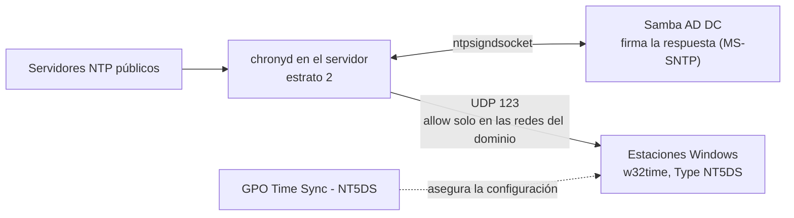

# samba-ad-time-sync

[Português](README.md) · [English](README.en.md) · **Español (Honduras)**

Corrige el desfase de hora de varios minutos entre las estaciones de trabajo Windows de un dominio Samba AD: el servidor empieza a responder la hora **firmada** (MS-SNTP) con chrony, y una GPO uniforma la configuración de los clientes.

## El problema

En un dominio Samba AD, algunas estaciones Windows tenían la hora desfasada por minutos, unas adelantadas y otras atrasadas. La hora desencontrada no es solo una molestia: Kerberos, que se usa en el inicio de sesión del dominio, tolera por defecto cerca de 5 minutos de diferencia, y los registros de eventos de máquinas distintas dejan de poder compararse.

Lo que encontramos:

- El servidor (controlador de dominio) tenía la hora **correcta**, sincronizada con servidores NTP públicos.
- Las estaciones medidas usaban `Local CMOS Clock` como fuente, estaban marcadas como "no sincronizado" y nunca habían sincronizado. La diferencia con el servidor era de cerca de 1.75 s, 11.2 s y 128 s.
- La configuración de los clientes ya era correcta (`Type: NT5DS`) y el dominio ya anunciaba al servidor como servidor de hora.
- La causa era que el servidor **no respondía hora firmada** a los clientes. Sin una respuesta válida, cada reloj seguía su propio hardware y se desviaba.

Este repositorio reúne el diagnóstico, los cambios y las validaciones que lo resolvieron.

## Cómo funciona (visión general)



En resumen:

- **`chronyd`** en el servidor se sincroniza con servidores NTP públicos y empieza a servir la hora a las redes habilitadas con la directiva `allow`.
- La directiva **`ntpsigndsocket`** conecta chrony con el socket de firma de Samba. Windows solo acepta la respuesta de un controlador de dominio si viene firmada, y quien la firma es Samba.
- El usuario `chrony` necesita **acceso al directorio** de ese socket (grupo `chrony`, modo 750). Es el único cambio de permisos.
- Los clientes con **`Type: NT5DS`** descubren el servidor de hora a través del propio dominio, sin apuntar a un servidor a mano.
- La **GPO** es la segunda capa: asegura que todas las estaciones tengan el cliente NTP habilitado y en NT5DS. No sustituye a un servidor sano.
- Para diferencias pequeñas, Windows corrige el reloj **poco a poco** (slew), sin saltos. Una diferencia de 11 s tardó cerca de 30 minutos en desaparecer.

## Estructura del repositorio

```
samba-ad-time-sync/
├── configs/    chrony.conf.example
└── docs/       pt-BR/, en/, es-HN/
                (runbook, revertir, lecciones aprendidas)
```

## Requisitos

- Un controlador **Samba AD DC** con soporte para `ntp_signd`. Confírmelo con `samba -b | grep -i NTP_SIGND_SOCKET_DIR`. La ruta del socket depende de la instalación (en este proyecto, Samba compilado desde el código fuente en `/usr/local/samba`).
- **chrony** con soporte de firma (`chronyd -v` debe mostrar `+SIGND`).
- Estaciones Windows unidas al dominio, con `w32time` y las herramientas `w32tm` y `gpresult`.
- Acceso a la Administración de directivas de grupo (RSAT) en una máquina del dominio.
- UDP 123 abierto entre las redes de las estaciones y el servidor.
- Sistema probado: Rocky Linux 10.x en una máquina virtual. Otras distribuciones deberían funcionar ajustando las rutas.

## Implementación, paso a paso

La guía completa, con todos los comandos, está en [docs/es-HN/runbook.md](docs/es-HN/runbook.md). En resumen:

1. **Diagnostique** el cliente: `w32tm /query /source`, `w32tm /query /status` y `w32tm /stripchart` contra el servidor. Una fuente `Local CMOS Clock` con "no sincronizado" indica que la estación no está usando el dominio.
2. **Confirme que el servidor está bien**: `chronyc tracking` con `Leap status: Normal` y un desfase pequeño.
3. **Dé acceso al socket de firma** al usuario `chrony` (`chgrp chrony` y `chmod 750` en el directorio `ntp_signd`).
4. **Haga una copia de respaldo** de `chrony.conf` y agregue las líneas de [configs/chrony.conf.example](configs/chrony.conf.example) (`allow` solo para las redes que tienen máquinas del dominio, y `ntpsigndsocket`).
5. **Reinicie `chronyd`** y confirme en el registro `MS-SNTP authentication enabled`.
6. **Pruebe en una estación**: `w32tm /resync /rediscover` y espere la corrección gradual.
7. **Aplique la GPO por fases**: primero sin vínculo, luego limitada a una estación de prueba, luego con filtro WMI de estaciones y, por último, para todas.
8. **Valide** y documente. Para deshacer cualquier parte, vea [docs/es-HN/rollback.md](docs/es-HN/rollback.md).

## Cómo validar

En el servidor:

```
chronyc tracking | grep -E "Stratum|Leap|System time"    # Leap status: Normal
ss -ulpn | grep ':123'                                   # chronyd escuchando
ls -ld /usr/local/samba/var/lib/ntp_signd                # grupo chrony, modo 750
journalctl -u chronyd | grep MS-SNTP                     # firma habilitada
```

En una estación Windows:

```
w32tm /query /source                                              # dc01.example.local
w32tm /query /status /verbose                                     # fuente autenticada, sin error
w32tm /stripchart /computer:dc01.example.local /samples:3 /dataonly   # diferencia de milisegundos
reg query "HKLM\SOFTWARE\Policies\Microsoft\W32time\Parameters"   # NtpServer y Type de la GPO
```

Lo esperado: fuente `dc01.example.local`, `Time Source Flags: 2 (Authenticated)` (o el equivalente en el idioma de su Windows) y `Last Sync Error: 0`.

## Problemas comunes

| Síntoma | Qué hacer |
|---|---|
| Estación con fuente `Local CMOS Clock` y "no sincronizado" | Revisar `allow`, `ntpsigndsocket` y el permiso del directorio `ntp_signd`; luego `w32tm /resync /rediscover` |
| El `resync` funcionó, pero la diferencia continúa | Es normal con diferencias pequeñas: Windows corrige poco a poco. Mida de nuevo en unos minutos |
| `stripchart` con error de tiempo agotado (`0x800705B4`) | UDP 123 bloqueado entre la red de la estación y el servidor (firewall o router) |
| La GPO parece no haber llegado | Consulte `NtpServer` y `Type` en `...\W32time\Parameters`, y no en `...\TimeProviders\NtpClient`. El nombre de la GPO aparece en `gpresult` incluso cuando fue filtrada, así que confirme con los valores del registro |
| El inicio de sesión falla con una diferencia mayor a unos 5 minutos | Límite de Kerberos: corrija la hora de la estación con `w32tm /resync` antes de investigar otra cosa |

## Estado de las pruebas y pendientes

Lo que **se verificó**:

- Servidor: `chronyd` sincronizado, firma habilitada, y el permiso del directorio `ntp_signd` **se mantuvo** después de reiniciar el servicio Samba y después de reiniciar el servidor.
- Clientes: la estación de prueba (WS-C) y dos más (WS-B y WS-D) pasaron a usar el servidor como fuente, con una diferencia de milisegundos.
- GPO: aplicada y confirmada por los valores del registro en dos estaciones, y liberada para todas las estaciones del dominio.

Lo que **todavía no se verificó**:

- **WS-A**, la estación que estaba cerca de 128 s desfasada: el usuario informó que su reloj ya estaba correcto, pero **no hubo medición técnica**.
- Una estación de cada red de estaciones, en OU distintas, después del ciclo de actualización de las GPO.
- Si alguna OU de computadoras tiene bloqueada la herencia de GPO.

## Aviso: datos ficticios

Todos los nombres de dominio, servidores y estaciones, direcciones IP y nombres de GPO de este repositorio son **ficticios**. El dominio es `example.local`, el servidor es `dc01`, las estaciones son `WS-A`, `WS-B`, `WS-C` y `WS-D`, y las IP pertenecen a los rangos reservados para documentación (`192.0.2.0/24`, `198.51.100.0/24` y `203.0.113.0/24`). Reemplace todo por los valores de su propio entorno. Nunca publique su `chrony.conf` real, exportaciones de GPO, registros ni capturas de pantalla: suelen contener nombres y direcciones de su red. El `.gitignore` ya excluye esos tipos de archivo.

## Hoja de ruta

Mejoras previstas y lecciones del proyecto: [ROADMAP.es-HN.md](ROADMAP.es-HN.md).

## Temas

`samba` · `samba-ad` · `active-directory` · `ntp` · `chrony` · `time-synchronization` · `ms-sntp` · `group-policy` · `gpo` · `windows-time` · `w32time` · `kerberos` · `rocky-linux` · `sysadmin` · `it-infrastructure`

## Licencia

GPL-3.0. Vea el archivo [LICENSE](LICENSE). Copyright (C) 2026 Manuel Pérez.
