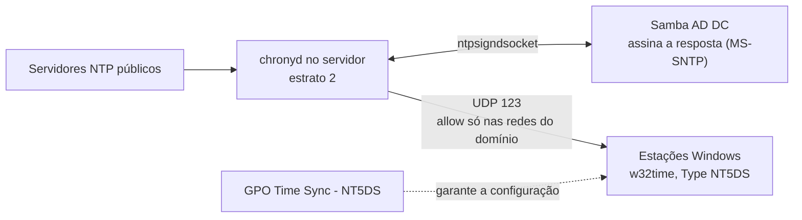

# samba-ad-time-sync

**Português** · [English](README.en.md) · [Español (Honduras)](README.es-HN.md)

Corrige o desvio de hora de minutos entre as estações Windows de um domínio Samba AD: o servidor passa a responder hora **assinada** (MS-SNTP) com o chrony, e uma GPO uniformiza a configuração dos clientes.

## O problema

Em um domínio Samba AD, algumas estações Windows estavam com a hora divergente em minutos, umas adiantadas e outras atrasadas. A hora desencontrada não é só incômodo: o Kerberos, usado no login do domínio, tolera por padrão cerca de 5 minutos de diferença, e os registros de eventos de máquinas diferentes deixam de ser comparáveis.

O que encontramos:

- O servidor (controlador de domínio) estava com a hora **correta**, sincronizada com servidores NTP públicos.
- As estações medidas usavam `Local CMOS Clock` como fonte, estavam marcadas como "não sincronizado" e nunca tinham sincronizado. A diferença para o servidor era de cerca de 1,75 s, 11,2 s e 128 s.
- A configuração dos clientes já estava certa (`Type: NT5DS`) e o domínio já anunciava o servidor como servidor de hora.
- A causa era o servidor **não responder hora assinada** aos clientes. Sem resposta válida, cada relógio seguia o próprio hardware e se desviava.

Este repositório reúne o diagnóstico, as alterações e as validações que resolveram isso.

## Como funciona (visão geral)



Em resumo:

- O **`chronyd`** do servidor sincroniza com servidores NTP públicos e passa a servir hora às redes liberadas pela diretiva `allow`.
- A diretiva **`ntpsigndsocket`** liga o chrony ao socket de assinatura do Samba. O Windows só aceita a resposta de um controlador de domínio se ela vier assinada, e é o Samba que assina.
- O usuário `chrony` precisa de **acesso ao diretório** desse socket (grupo `chrony`, modo 750). É a única mudança de permissão.
- Os clientes com **`Type: NT5DS`** descobrem o servidor de hora pelo próprio domínio, sem apontar um servidor à mão.
- A **GPO** é a segunda camada: garante que todas as estações estejam com o cliente NTP habilitado e em NT5DS. Ela não substitui um servidor saudável.
- Para diferenças pequenas, o Windows corrige o relógio **aos poucos** (slew), sem salto. Uma diferença de 11 s levou cerca de 30 minutos para sumir.

## Estrutura do repositório

```
samba-ad-time-sync/
├── configs/    chrony.conf.example
└── docs/       pt-BR/, en/, es-HN/
                (runbook, reverter, lições aprendidas)
```

## Pré-requisitos

- Um controlador **Samba AD DC** com suporte a `ntp_signd`. Confirme com `samba -b | grep -i NTP_SIGND_SOCKET_DIR`. O caminho do socket depende da instalação (neste projeto, Samba compilado do código-fonte em `/usr/local/samba`).
- **chrony** com suporte a assinatura (`chronyd -v` deve mostrar `+SIGND`).
- Estações Windows ingressadas no domínio, com `w32time` e as ferramentas `w32tm` e `gpresult`.
- Acesso ao Gerenciamento de Política de Grupo (RSAT) em uma estação do domínio.
- UDP 123 liberada entre as redes das estações e o servidor.
- Sistema testado: Rocky Linux 10.x em máquina virtual. Outras distribuições devem funcionar, ajustando os caminhos.

## Passo a passo de implantação

O guia completo, com todos os comandos, está em [docs/pt-BR/runbook.md](docs/pt-BR/runbook.md). Resumindo:

1. **Diagnostique** o cliente: `w32tm /query /source`, `w32tm /query /status` e `w32tm /stripchart` contra o servidor. Fonte `Local CMOS Clock` e "não sincronizado" indicam que a estação não está usando o domínio.
2. **Confirme que o servidor está certo**: `chronyc tracking` com `Leap status: Normal` e diferença pequena.
3. **Dê acesso ao socket de assinatura** ao usuário `chrony` (`chgrp chrony` e `chmod 750` no diretório `ntp_signd`).
4. **Faça backup** do `chrony.conf` e acrescente as linhas de [configs/chrony.conf.example](configs/chrony.conf.example) (`allow` só para as redes com máquinas do domínio e `ntpsigndsocket`).
5. **Reinicie o `chronyd`** e confirme no log `MS-SNTP authentication enabled`.
6. **Teste em uma estação**: `w32tm /resync /rediscover` e espere a correção gradual.
7. **Aplique a GPO em fases**: sem vínculo, depois restrita a uma estação de teste, depois com filtro WMI de estações e, por fim, para todas.
8. **Valide** e documente. Para desfazer qualquer parte, veja [docs/pt-BR/rollback.md](docs/pt-BR/rollback.md).

## Como validar

No servidor:

```
chronyc tracking | grep -E "Stratum|Leap|System time"    # Leap status: Normal
ss -ulpn | grep ':123'                                   # chronyd escutando
ls -ld /usr/local/samba/var/lib/ntp_signd                # grupo chrony, modo 750
journalctl -u chronyd | grep MS-SNTP                     # assinatura habilitada
```

Em uma estação Windows:

```
w32tm /query /source                                              # dc01.example.local
w32tm /query /status /verbose                                     # Fonte autenticada, sem erro
w32tm /stripchart /computer:dc01.example.local /samples:3 /dataonly   # diferença de milissegundos
reg query "HKLM\SOFTWARE\Policies\Microsoft\W32time\Parameters"   # NtpServer e Type da GPO
```

O esperado é a fonte `dc01.example.local`, `Sinalizadores de Fonte de Tempo: 2 (Autenticado)` (ou o equivalente no idioma do Windows) e `Último Erro de Sincronização: 0`.

## Problemas comuns

| Sintoma | O que fazer |
|---|---|
| Estação com fonte `Local CMOS Clock` e "não sincronizado" | Conferir o `allow`, o `ntpsigndsocket` e a permissão do diretório `ntp_signd`; depois `w32tm /resync /rediscover` |
| O `resync` deu certo, mas a diferença continua | Normal para diferenças pequenas: o Windows corrige aos poucos. Meça de novo em alguns minutos |
| `stripchart` com erro de tempo esgotado (`0x800705B4`) | UDP 123 bloqueada entre a rede da estação e o servidor (firewall ou roteador) |
| A GPO parece não ter chegado | Consulte `NtpServer` e `Type` em `...\W32time\Parameters`, e não em `...\TimeProviders\NtpClient`. O nome da GPO no `gpresult` aparece até quando ela foi filtrada, então confirme pelos valores no registro |
| Login falha com diferença acima de cerca de 5 minutos | Limite do Kerberos: corrija a hora da estação com `w32tm /resync` antes de investigar outra coisa |

## Status dos testes e pendências

O que foi **verificado**:

- Servidor: `chronyd` sincronizado, assinatura habilitada, e a permissão do diretório `ntp_signd` **persistiu** depois de reiniciar o serviço Samba e depois de reiniciar o servidor.
- Clientes: a estação de teste (WS-C) e mais duas (WS-B e WS-D) passaram a usar o servidor como fonte, com a diferença na casa de milissegundos.
- GPO: aplicada e confirmada pelos valores no registro em duas estações, e liberada para todas as estações do domínio.

O que **não foi verificado** ainda:

- **WS-A**, a estação que estava cerca de 128 s fora: o usuário relatou que o relógio já estava correto, mas **não houve medição técnica**.
- Uma estação de cada rede de estações, em OUs diferentes, depois do ciclo de atualização das GPOs.
- Se alguma OU de computadores tem a herança de GPOs bloqueada.

## Aviso: dados fictícios

Todos os nomes de domínio, servidores e estações, endereços IP e nomes de GPO deste repositório são **fictícios**. O domínio é `example.local`, o servidor é `dc01`, as estações são `WS-A`, `WS-B`, `WS-C` e `WS-D`, e os IPs pertencem às faixas reservadas para documentação (`192.0.2.0/24`, `198.51.100.0/24` e `203.0.113.0/24`). Troque tudo pelos valores do seu ambiente. Nunca publique o seu `chrony.conf` real, exportações de GPO, logs ou capturas de tela: eles costumam conter nomes e endereços da sua rede. O `.gitignore` já exclui esses tipos de arquivo.

## Roadmap

Melhorias previstas e aprendizados do projeto: [ROADMAP.md](ROADMAP.md).

## Tópicos

`samba` · `samba-ad` · `active-directory` · `ntp` · `chrony` · `time-synchronization` · `ms-sntp` · `group-policy` · `gpo` · `windows-time` · `w32time` · `kerberos` · `rocky-linux` · `sysadmin` · `it-infrastructure`

## Licença

CC BY-SA 4.0. Veja o arquivo [LICENSE](LICENSE). Copyright (C) 2026 Manuel Pérez.
